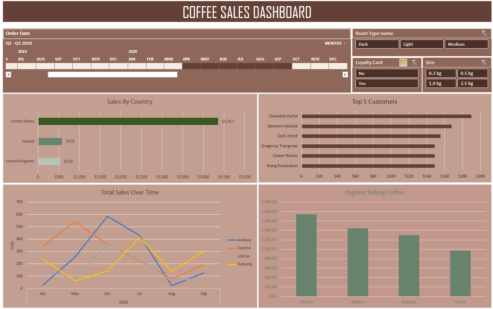

# ☕ Coffee Sales Dashboard

## Project Overview
An Excel-based data analytics project analyzing coffee sales from 2019 to 2022. The dashboard explores sales trends across countries, coffee types, and customer loyalty-card categories.

## Objectives
- Analyze sales trends over four years.
- Compare sales across countries and coffee types.
- Evaluate sales differences between loyalty-card holders and non-cardholders.
- Present business insights through charts and interactive filters.

## Tools Used
- Microsoft Excel
- PivotTables
- PivotCharts
- Slicers and Timeline

## Key Business Insights

- **Geographic Performance:** The United States recorded the highest country-level sales among the reported high and low values, while the United Kingdom recorded the lowest.
- **Loyalty-Card Analysis:** Across all four years, non-cardholders generated $24,216.41 in sales, compared with $20,917.85 for cardholders.
- **Yearly Trends:** Both loyalty groups recorded their highest annual sales in 2021, followed by lower sales in 2022.
- **Product Analysis:** Robusta recorded the lowest total sales at $9,005.25, suggesting an opportunity to investigate its sales volume, customer demand, and profitability.
- **Top-Performing Coffee:** Excelsa generated the highest total sales at $12,306.44, followed by Liberica at $12,054.08.
- 
## Dashboard Preview

## Files Included
- Excel workbook containing the sales analysis and dashboard.
- Dashboard screenshot for visual reference.

## Skills Demonstrated
- Data analysis and summarization
- PivotTable and PivotChart creation
- Sales trend analysis
- Business insight generation

## Acknowledgment
This project was developed as part of my learning journey in data analytics, with guidance from a YouTube tutorial. 

by: Mo Chen

Link: https://youtu.be/m13o5aqeCbM?si=If3w1pvBaaMWQZ4e

The project helped me practice Excel-based data analysis, PivotTables, PivotCharts, interactive filters, and business insight generation. I also explored the sales data to interpret trends and compare customer segments.

## Author
Pallavi Saxena
